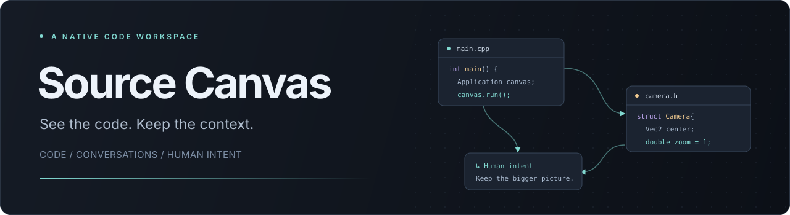
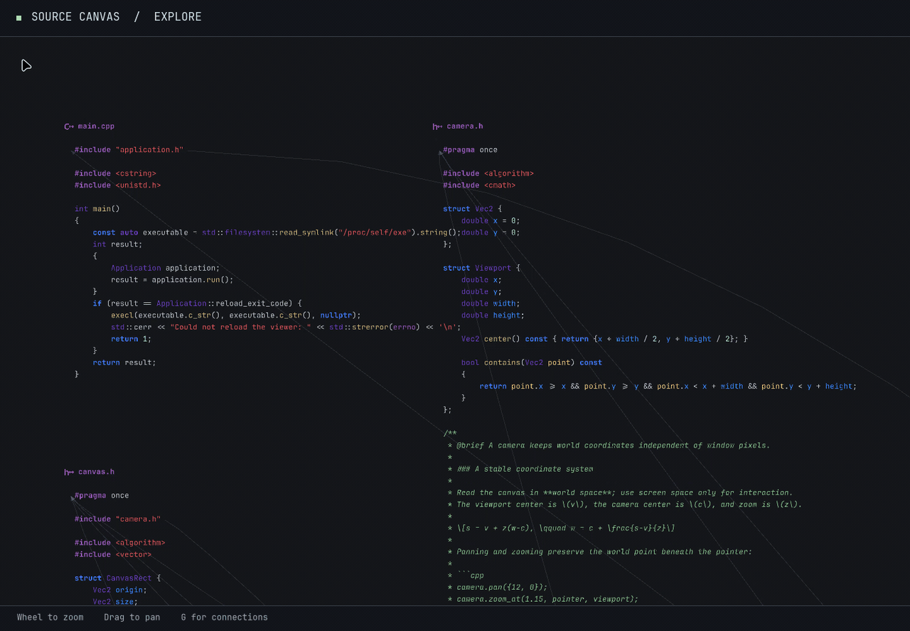
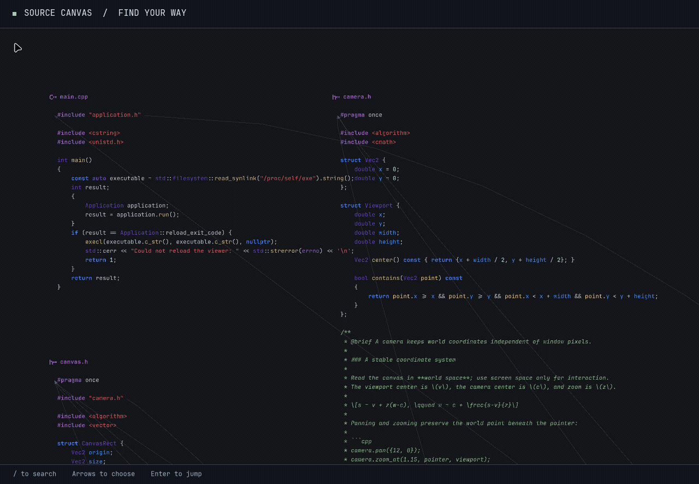

<p align="center">
  
</p>

<p align="center">
  <a href="https://github.com/nuxdie/code-exp-02/actions/workflows/quality.yml"></a>
  
  
  
</p>

<p align="center">
  <strong>Your source tree, laid out in space.</strong><br>
  Explore code, follow its connections, and work with agents beside the source.
</p>

<p align="center">
  <a href="#see-it-in-motion">Demos</a> ·
  <a href="#get-running">Get running</a> ·
  <a href="#find-your-way">Controls</a> ·
  <a href="#under-the-hood">Architecture</a> ·
  <a href="#development">Development</a>
</p>

---

Source Canvas is an experimental native Linux workspace that turns a source tree into a zoomable canvas. Files become movable cards, dependencies become visible connections, and agent conversations live next to the code they discuss. A separate intent view connects human decisions to Git changes and line history.

Image files appear as preview cards alongside source, including images in `assets/`. PNG, JPEG, SVG, GIF, BMP, TIFF, ICO and WebP extensions are recognized; decoding depends on installed GdkPixbuf loaders. Previews preserve transparency and aspect ratio, fit within 640 canvas units, and reload when edited. Animated images show a still frame. Invalid or unsupported images show an error card.

The repository is named `code-exp-02`; the executable is currently called `white_window`.

Live agent edits appear on the canvas as colored figures that fly from their conversation cards to the changed lines. Each conversation keeps a stable color; a brief beam and fading line highlight show each touch, including edits inside folded code. This uses successful live file-change events; shell-only writes without file-change events have no attributed figure. Animations fade out and stop when idle.

## See it in motion

### From the project to the details

Pan between files and zoom around the pointer. Syntax stays sharp as the camera moves; dependency arrows keep related files connected.

Use **Alt+Left / Alt+Right** or your mouse's **back / forward buttons** to revisit camera positions and zoom levels after panning, zooming, fitting, or jumping to code and conversations. Continuous movement counts as one step. Moving somewhere new after going back clears the forward history; the last 100 positions are saved with the project session.



### Find it. Jump to it.

Press `/` to search file names and source text. Results update as you type; use the arrow keys and `Enter` to jump directly into the source.



<sub>Both GIFs are recordings of the native application browsing this repository, with agent connections disabled.</sub>

## A workspace with context

| Capability | What you can do |
| --- | --- |
| **Spatial source browsing** | Move file cards, fold blocks, fit the canvas, and arrange files with Graphviz. Toggle arrows for include and build dependencies. |
| **Language navigation** | Inspect documentation, definitions, references, symbols, diagnostics, and completion suggestions through `clangd` and `neocmakelsp`. |
| **Conversations beside the code** | Open an agent conversation at the pointer. The app attaches source location, selected text, and visible-file context. Keep multiple conversation cards on the canvas. |
| **Human intent and history** | Click a file's intent label for concise requests, then select one to read its explanation beside the code. Inspect line history and associate reviewed Git checkpoints with a human statement and an explicit rationale. |
| **Live source updates** | Watch project files for changes. With agents enabled, the viewer can rebuild and restart itself while preserving session state. |
| **Rich reading** | Read formatted documentation, code blocks, and LaTeX equations; select and copy text across source, conversations, and popups. The canvas follows the desktop theme. |

## Get running

The current target is **Linux with an X11 display and OpenGL 3.3 or newer**. Mesa software rendering also works for headless checks. Build with a C++17 compiler and CMake 3.16 or newer.

### 1. Clone the project

```bash
git clone https://github.com/nuxdie/code-exp-02.git
cd code-exp-02
```

### 2. Install dependencies

The following package list matches the project's Ubuntu 24.04 CI environment:

```bash
sudo apt-get update
sudo apt-get install -y \
  cmake cmake-format g++ pkg-config python3 python3-websockets \
  clang-format-18 clang-tidy-18 clangd-18 \
  libx11-dev libpango1.0-dev libfontconfig1-dev librsvg2-dev \
  libepoxy-dev nlohmann-json3-dev graphviz \
  texlive-latex-base dvisvgm \
  xvfb xauth libgl1-mesa-dri libglx-mesa0 zenity
```

Install the pinned CMake language server; the installer verifies the release archive's SHA-256 checksum:

```bash
python3 tools/install_cmake_lsp.py
```

The installer supports Linux x86-64 and ARM64. On other architectures, provide `neocmakelsp` on `PATH` before configuring.

### 3. Build and open

```bash
cmake -S . -B build -DCMAKE_BUILD_TYPE=Release
cmake --build build --parallel 2
./build/white_window
```

The viewer opens its own source tree by default, regardless of your current directory. To browse another project, pass its directory as an argument (absolute or relative):

```bash
./build/white_window /path/to/your/project
./build/white_window .
```

Press **Ctrl+O** to choose a project directory in a native folder picker (provided by Zenity). Selecting a different directory saves the current session and reopens the viewer on that project; canceling keeps the current workspace. Explicit directory arguments are preserved across automatic viewer reloads.

Bundled fonts and icons are copied into `build/`; keep them beside the executable. Each project keeps its own session and decisions. Automatic viewer rebuilds run only when browsing the viewer's own source tree.

> CMake configuration automatically formats the project's C++ and CMake files. Formatting tools, Python `websockets`, Graphviz, and the LaTeX tools are configure-time requirements.

### Agent conversations

The agent bridge expects an authenticated local Codex installation available as `codex` on `PATH` or in `~/.local/bin`. Set `SOURCE_CANVAS_CODEX` to use an explicit executable path. It reuses a running app-server daemon when available and otherwise starts a server over standard input/output. See [`tools/agent_bridge.py`](tools/agent_bridge.py) for the transport.

New canvas threads currently run with full filesystem access and no approval prompts.

Ask a new canvas conversation to **“show me how this is wired”**. Its `canvas_walkthrough` tool can arrange up to twelve focused source excerpts together, including multiple ranges from one file, with numbered steps, explanations, and labeled arrows. It controls horizontal, vertical, grid, or explicit positions and can focus or clear the walkthrough. Drag excerpt titles to adjust the layout, click code to open its original source line, or middle-click the walkthrough to dismiss it. Excerpts show live source at the specified line ranges, and the walkthrough survives session reloads. Ranges follow line numbers; review them after edits that move code.

The tool is registered when a thread is created and retained when that thread resumes, using the [Codex app-server dynamic tool protocol](https://learn.chatgpt.com/docs/app-server#dynamic-tool-calls-experimental). Conversations created before this feature need a new thread to use it.

To browse the source with agent connections disabled:

```bash
SOURCE_CANVAS_DISABLE_AGENT=1 ./build/white_window
```

Source browsing, search, and language navigation remain available in this mode. Automatic viewer rebuilds and session saving are tied to agent mode and are disabled with it.

## Find your way

Start with **`/`** to find a file, **`F`** to see the whole canvas, and **`F1`** for the complete in-app guide.

| Action | Control |
| --- | --- |
| Open a project directory | `Ctrl+O` |
| Zoom around the pointer | Mouse wheel |
| Pan | Drag blank space, middle-drag on source or blank canvas, or arrow keys |
| Move a card | Drag its title |
| Fit everything / fit width / reset view | `F` / `W` / `0` |
| Arrange files / toggle dependency arrows | `L` / `G` |
| Search the project | `/`, then `↑` / `↓` and `Enter` |
| Read symbol documentation | Hover or `K` |
| Go to definition / usages / back | `Ctrl+click` or `F12` / `Shift+F12` / `Alt+Left` |
| Show symbols / collapse or expand blocks | `S` / `C` or `Shift+C` |
| Open a contextual conversation | Right-click or `Ctrl+Shift+A` |
| Close a conversation, intent card, search, or popup | Middle-click it |
| Focus the active conversation / send / insert newline | `Tab` or `Ctrl+L` / `Enter` / `Shift+Enter` |
| Browse all intents / inspect a source line's intent | `D` / `I` or `Alt+click` |
| Select / copy text | Drag / `Ctrl+C` |
| Help / dismiss | `F1` or `?` / `Esc` |

At a definition, `Ctrl+click` shows usages. Letter shortcuts apply when you are outside a text editor. The wheel continues to zoom over conversation cards; drag their scrollbar to read longer threads.

<details>
<summary><strong>Workspace and session options</strong></summary>

Session state normally lives in `.cache/canvas-session.json` and preserves the camera, file positions, folds, conversations, drafts, and search state. Human decisions live separately in `.canvas/decisions.json` and are versioned with the code.

| Environment variable | Effect |
| --- | --- |
| `SOURCE_CANVAS_PROJECT_ROOT=/absolute/path` | Select a project when no directory argument is passed (relative paths also work). A directory argument takes precedence. Language tools use this project's compilation database in its root or `build/`, with `.cache/source-canvas/` as a fallback for generated files. |
| `SOURCE_CANVAS_DISABLE_AGENT=1` | Disable agent connections, automatic viewer rebuilds, and session saving. |
| `SOURCE_CANVAS_AUTO_BUILD=0` | Keep agent connections but disable automatic viewer rebuilds and reloads. |
| `SOURCE_CANVAS_STATE_FILE=/absolute/path.json` | Use a separate canvas session file. |
| `SOURCE_CANVAS_DISABLE_SESSION=1` | Skip restoring and saving the session. |
| `SOURCE_CANVAS_AGENT_SOCKET=/path/to/socket` | Connect the agent bridge to a specific local app-server socket. |

</details>

## Under the hood

The interface is built directly on X11 and OpenGL. Pango/Cairo shape text, an OpenGL renderer draws the canvas, and Graphviz lays out the source graph. Language servers and the agent bridge communicate asynchronously with the application.

| Area | Start reading here |
| --- | --- |
| Application and event loop | [`main.cpp`](main.cpp), [`application.cpp`](application.cpp), [`application_events.cpp`](application_events.cpp) |
| Camera, geometry, and GPU rendering | [`camera.h`](camera.h), [`canvas.h`](canvas.h), [`gpu.cpp`](gpu.cpp) |
| Source cards, dependencies, and file watching | [`application_model.cpp`](application_model.cpp), [`source_graph.cpp`](source_graph.cpp), [`project_watch.cpp`](project_watch.cpp) |
| Language servers and documentation | [`lsp.cpp`](lsp.cpp), [`application_language.cpp`](application_language.cpp), [`popup_markup.cpp`](popup_markup.cpp), [`math_typesetter.cpp`](math_typesetter.cpp) |
| Agent conversations | [`conversation.cpp`](conversation.cpp), [`agent_client.cpp`](agent_client.cpp), [`tools/agent_bridge.py`](tools/agent_bridge.py) |
| Intent and Git provenance | [`application_intent.cpp`](application_intent.cpp), [`tools/provenance_store.py`](tools/provenance_store.py), [`tools/provenance_git.py`](tools/provenance_git.py) |
| Build, tests, and quality policy | [`CMakeLists.txt`](CMakeLists.txt), [`tests/`](tests/), [`tools/quality.py`](tools/quality.py) |

## Development

Run the same quality gate used by GitHub Actions. It checks formatting, module size, include cycles, static analysis, and tests, including GPU checks under a virtual X display:

```bash
xvfb-run -a python3 tools/quality.py --build --jobs 2
```

For a test-only pass after building:

```bash
xvfb-run -a ctest --test-dir build --output-on-failure
```

The repository's commit hook requires an `Intent-ID` trailer linked to a recorded human decision. Changed artifacts need a matching path binding and an explicit rationale in `.canvas/decisions.json`. The intent service implements previewed checkpoints; see [`tools/provenance_store.py`](tools/provenance_store.py).

### Credits

Typography: [JetBrains Mono](fonts/OFL.txt) and [Noto Serif](fonts/noto-serif/LICENSE). File icons: [vscode-icons](assets/vscode-icons/LICENSE). Their source and license files are included alongside the assets.
